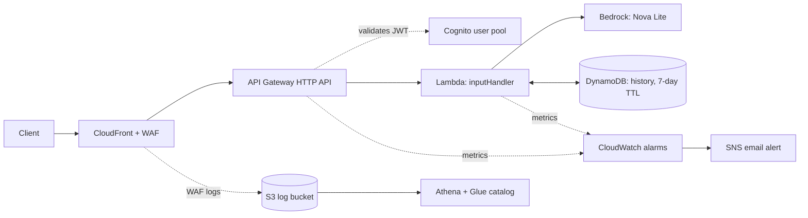

# Serverless AI Chatbot on AWS

## Summary
A serverless architecture that allows for a user to sign in with Cognito, Validate their token with API Gateway, Send a message to Lambda, and get a response back from an AI model in Bedrock. User conversation history is stored by DynamoDB to allow for AI context and chat history. Logs are generated by WAF, stored by S3, and queried by Athena. WAF handles rate-limiting and blocks known malicious IPs. It also has other security rules.

## Topics Learned
- I learned about how sitting CloudFront in front of HTTP API allows for WAF, which is used to protect against malicious traffic. HTTP API is cheaper than REST, but you pay for it in WAF costs.
- DynamoDB is a good database for projects with scaling as using on-demand instead of provisioning allows for costs to scale with use. (Lower use = Less costs)
- I found out Athena bills by the amount of data a query scans, so filtering by timestamp (and keeping logs compressed in S3) keeps amount of data accessed in queries reduced.
- IAM users need to be setup with least privileges in order to reduce damage of a compromised user/credentials.
- Root shouldn't be used for daily tasks as it risks compromising account and that IAM should be used to create a 2nd IAM User for daily tasks.
- I ran into trailing slashes for issuer URLs causing issues with JWT authorizer, as the API compares them exactly.
- WAF will still show missing token requests as "ALLOW" because token requests are validated by API's JWT authorizer, not WAF
- I ran into the issue that SQL --Comments at the top of a create external table in Athena cause it to run into an EOF error. Table was documented in the README.md in the Athena folder.
- I saw that redacting the authorization header made it so that the Authorization header appears as REDACTED in the WAF logs, keeping tokens out of S3.
- I found that the API Gateway’s default execute-api URL is publicly reachable and bypasses CloudFront, so WAF never sees those requests. The JWT authorizer still protects the route, but WAF rules and logs don’t cover that path.
- Used a unit test to test invalid inputs, setting up a fake bedrock allows for testing without AWS calls. 
- Changed the CloudFront-created rate-based rule from Count to Block, and tested it: sending more than 300 requests in five minutes from one IP returned 403.
- Upon viewing Cost Explorer, WAF’s fixed monthly fees (web ACL plus rules, about $10/month) were the cost, not per-request charges. Credits were hiding it until I checked the Charge type filter.”

## Architecture



## Request flow

1. The client signs in with Cognito and receives a JWT.
2. The request goes to CloudFront (protected by a WAF web ACL), which forwards the
   `Authorization` header and does not cache responses.
3. API Gateway's JWT authorizer validates the token. Invalid or missing token: 401.
4. Lambda validates the body and limits (2,000-character message, 128-character
   session ID), then reads the user ID (`sub`) from the verified token, never from
   the request body.
5. Lambda loads up to the last 5 exchanges (capped at 6,000 characters) from DynamoDB,
   calls Bedrock's Converse API, saves the new exchange, and returns the reply.

## Services: what, why, cost, trade-off

| Service | Role here | Why this one | Cost model | Trade-off |
|---|---|---|---|---|
| CloudFront | Entry point, forwards to API Gateway | Used to attach WAF to HTTP API | Console Billing shows pay-as-you-go. CloudFront also offers a Free plan, which lists 5 WAF rules and no WAF request logs (AWS docs).| Extra service to manage. Requests to the default execute-api URL bypass WAF rules and logging (tested). Alternatives: REST API + WAF (fewer pieces, but costlier API and no native JWT authorizer), or nothing in front (simplest, no WAF). |
| AWS WAF | Filters requests, writes logs | WAF uses rules to provide security for CloudFront. It rate limits IP Addresses to allow for protection of the bedrock bill and covers known malicious IPs and exploits | $5/month per web ACL plus $1/month per rule. With 5 rules that’s about $10/month, matching Cost Explorer’s ~$0.32/day, split equally between WebACL and Rule usage types.| Comes with a SQL-injection rule but project doesn't use a SQL database, raw-URL Bypass, Expected that changing IP could bypass rate-limit. | 
| API Gateway (HTTP API) (us-east-2) | Routes `POST /chat`, runs JWT authorizer | HTTP comes with minimal features and is therefore cheaper to implement than REST | 1$/1M Requests for the first 300M requests per month | Lacks API Keys, Per-Client Throttling, Request Validation, WAF Integration. |
| Cognito (us-east-2) | User sign-in, issues tokens | This uses AWS Services to handle token generation, account creation, and the storing of account information. | Free for the first 10,000 monthly users, $0.015 per monthly active user, Essentials tier, from the pricing page’s examples. | Validating and completing challenges (verification) to generate an auth token takes a bit of technical finesse and patience. Can sometimes run into issues with token generation, I noticed taking too long caused expired session strings, and users need to make a different password than the one the admin created. |
| Lambda (us-east-2) | Validation, history, Bedrock call | Lambda hosts serverless logic code that only runs when called. It was used to validate user input before sending to bedrock. Also handled sending user and assistant messages to DynamoDB for message history. | Free Tier: 1M requests and 400k GB-seconds, Then its $0.0000166667/GB-second (x86) for the first 6 billion GB-seconds, and $0.20 per 1M requests. | Code can only live for 15m, Can't rely on complex code that require persistent states between invocations, Cold-Starts (First starts) can have considerable delay. Should call boto3 clients at the module level, they will be reused on warm invocations. Due to this execution enviorment is shared across requests, therefore per-user data must never be stored. |
| Bedrock (Nova Lite) (us-east-2)| Generates replies | Cost-effective for testing, cheap cost per token. | $0.06 per 1M input tokens and $0.24 per 1M output tokens (Nova Lite, Standard tier, US East (Ohio); AWS Bedrock pricing page, checked 2026-10-11). | Smaller model, so it may be less capable than frontier models on complex questions. |
| DynamoDB (us-east-2)| Conversation history (on-demand, Standard class, TTL) | On-Demand provides more/less read/write as traffic changes. Billed only for reads/writes used. A TTL helps keep storage from growing by expiring old history items. | (No on-demand request free tier listed) $0.625 per 1M writes (1KB), $0.125 per 1M reads (4KB), $0.25 per GB-month | Using On-Demand pays for requests which is disadvantageous for applications with steady traffic as it could cost more, Queries that require multiple keys require planning at creation of database and joins/ad-hoc queries are not supported by DynamoDB. |
| S3 + Athena + Glue catalog (us-east-1) | WAF log storage and SQL analysis | Longer term storage of logs, Stores compressed logs as durable storage and glue catalogs contain S3 table definition and allows Athena to query the table. |  S3 Standard: $0.023 per GB-month, $0.005 per 1000 PUT/COPY/POST/LIST request, and $0.0004 per GET/SELECT and other requests. Athena: $5 per TB of data scanned. Glue catalog: First 1M objects and 1M requests free, $1 per 100,000 objects or 1M requests per month. | WAF has a delay of about 5m before logs can be accessed. Requires filters otherwise Athena will scan everything (Costs increase by data scanned), so a partition projection "log_time" allows for Athena to only scan specific timeframes. Athena is for reading logs, so any attacks will not be alerted. |
| CloudWatch + SNS + Budgets (Cloudwatch/SNS: us-east-2; Budgets: Global)| Error alarms and cost alert by email | SNS email was used because of ease of creation. Cloudwatch is used to alert for Lambda or API Gateway 5xx errors. Budgets is used to check the current/expected costs of services and keep track and send an alert when costs grow unexpectedly or hit the configured threshold. | (Cloudwatch) Free: 5GB of data, 1,800 minutes of Live tail usage per month, 10 metrics, 1M api requests, 10 alarm metrics. With $0.10 per alarm metric. (SNS) Free: 1M Mobile notifications, 1000 emails, 100,000 HTTP/s. After that: $0.50 per 1M mobile, $2 per 100,000 emails, $0.60 per 1M HTTP/s. (Budgets) Free: First two action-enabled budgets per month, after $0.10 per action-enabled budget per day. | Email can only be seen when user opens email. CloudWatch alarms only cover what's configured. Budgets don't set a hard cap, and are only for alerting and only update 3 times a day, so expect a delay before being notified. |
| IAM | Least-privilege role for Lambda, IAM user for daily work | To allow Lambda to only write to one table in DynamoDB database, A leaked daily credential won't compromise the whole AWS account, Reduce damage of a compromised Lambda. | IAM has no additional charge; you're charged only for the AWS services accessed with IAM users or roles (AWS IAM docs). | Lambda has "AmazonBedrockFullAccess" which give more than needed permissions. Requires technical knowledge to be precise with permissions. Admin account that is still with broad permissions has MFA. |

## Security notes

- **Authentication:** API Gateway's JWT authorizer validates each token (issuer, audience/client ID, expiry) before Lambda runs. Missing or invalid token: 401.
- **Per-user isolation:** the history key is `<Cognito sub>#<sessionId>`. The `sub` comes from the verified token, never from the request body, so a user can't ask for another user's history.
- **Input limits:** Lambda rejects bad input (400) before calling Bedrock: 2,000-character message, 128-character session ID.
- **Least-privilege Lambda role:** the inline policy allows `Query` and `PutItem` on one DynamoDB table. It cannot delete items, scan, or touch other tables. (`PutItem` can replace an item that has the same key.)
- **Generic client errors:** Bedrock failures return a generic 502 instead of the real error.
- **WAF:** the web ACL on CloudFront includes a rate-based rule (300 requests per 5 minutes per IP, action Block, tested: returned 403 after the limit) plus AWS managed rule groups.
- **Log hygiene:** the `Authorization` header is redacted in WAF logs, so tokens don't land in S3 (shows as `REDACTED`).
- **Account hygiene:** daily work uses an IAM user, not root. MFA is enabled on both. No root access keys exist.

## Testing

`test_inputHandler.py` has 33 unit tests (`py -m pytest -v`, all passing locally). They call the handler with fake Bedrock and DynamoDB objects, so no AWS calls are made.

- **Input validation:** invalid JSON, missing or null body, non-object JSON, extra fields, whitespace-only message, non-string session ID, and exact-at-limit vs over-limit for message (2,000) and session ID (128). Bad input returns 400 and never calls Bedrock.
- **Bedrock call:** request shape and argument names, success path (200 and reply), Bedrock failure or malformed response returns a generic 502.
- **History:** sent oldest first, only the newest five exchanges are read, a character budget drops the oldest, and the window stops at an oversized exchange instead of skipping it.
- **Saving:** a successful chat saves one exchange with a TTL; failed or malformed Bedrock responses and blank replies save nothing.
- **Per-user isolation and auth:** history keys include the user ID (verified with a fake table), and a missing user claim returns 401 without touching the table.
- **Resilience:** if loading or saving history fails, the chat still answers.

Not covered: real AWS behavior, IAM permissions, WAF rules and deployment configuration. I checked those by hand (401 without a token, 403 after the rate limit, history isolation in the real table).

## Log analysis

WAF logs go to an S3 bucket (`aws-waf-logs-` prefix, delivered as gzip files about every 5 minutes). An Athena table over that bucket (Glue Data Catalog, partition projection, no crawler) lets me query them with SQL. Queries are in `athena/`:

- `01_create_table.sql`: table definition (fill in the placeholders)
- `02_rules_by_action.sql`: requests by action and terminating rule
- `03_top_countries.sql`: top countries
- `04_requests_per_hour.sql`: requests per hour

Always filter on `log_time` (UTC). Athena bills by data scanned, and the filter limits which S3 folders are read. Details and the `--` comment gotcha are in `athena/README.md`.

## Known limitations

- **Raw API URL bypasses CloudFront.** The default `execute-api` URL is publicly reachable, so WAF rules and logs don't cover it. Tested: those requests never appear in the WAF logs. The JWT authorizer still protects the route.
- **Rate limit is per IP.** Changing IP can bypass it.
- **History failures are silent.** If loading or saving history fails, the chat continues without it, and nothing alerts me.
- **Broad Bedrock permission.** The Lambda role uses `AmazonBedrockFullAccess`, which is broader than needed.
- **TTL deletion not yet observed.** TTL is enabled (7 days), but I haven't seen an item expire. AWS says deletion happens in the background after expiry.
- **Console-built.** Resources were created by hand in the console, so they aren't reproducible yet.
- **WAF logging cost confirmed** WAF costs about $10/month (web ACL $5 plus 5 rules at $1 each, per the WAF pricing page, matching Cost Explorer’s ~$0.32/day). Account credits currently cover it, but it will bill normally once they run out or expire. The distribution is pay-as-you-go because flat-rate plans need a paid account. Cost Explorer was showing WAF costs netting to zero with credits included.
- **Daily IAM user is an administrator,** protected by MFA.
- **Alerts:** email alarms cover Lambda errors and API 5xx only. Budgets alert on cost but don't cap spending.

## Repository layout

```
inputHandler.py          Lambda handler
test_inputHandler.py    unit tests
athena/                 table definition, saved queries, notes
README.md
```

## Sources

AWS documentation and pricing pages used:

- [Lambda pricing](https://aws.amazon.com/lambda/pricing/), [quotas](https://docs.aws.amazon.com/lambda/latest/dg/gettingstarted-limits.html), [execution environment](https://docs.aws.amazon.com/lambda/latest/dg/lambda-runtime-environment.html), [best practices](https://docs.aws.amazon.com/lambda/latest/dg/best-practices.html)
- [Bedrock pricing](https://aws.amazon.com/bedrock/pricing/), [Nova Lite model card](https://docs.aws.amazon.com/bedrock/latest/userguide/model-card-amazon-nova-lite.html)
- [DynamoDB on-demand pricing](https://aws.amazon.com/dynamodb/pricing/on-demand/), [capacity modes](https://docs.aws.amazon.com/amazondynamodb/latest/developerguide/capacity-mode.html)
- [S3 pricing](https://aws.amazon.com/s3/pricing/), [Athena pricing](https://aws.amazon.com/athena/pricing/), [Glue pricing](https://aws.amazon.com/glue/pricing/)
- [CloudWatch pricing](https://aws.amazon.com/cloudwatch/pricing/), [SNS pricing](https://aws.amazon.com/sns/pricing/), [Budgets pricing](https://aws.amazon.com/aws-cost-management/aws-budgets/pricing/), [Budgets docs](https://docs.aws.amazon.com/cost-management/latest/userguide/budgets-managing-costs.html)
- [IAM introduction](https://docs.aws.amazon.com/IAM/latest/UserGuide/introduction.html)
- [CloudFront pricing](https://aws.amazon.com/cloudfront/pricing/), [CloudFront flat-rate pricing plans](https://docs.aws.amazon.com/AmazonCloudFront/latest/DeveloperGuide/flat-rate-pricing-plan.html)
- [AWS WAF pricing](https://aws.amazon.com/waf/pricing/), [WAF logging to S3](https://docs.aws.amazon.com/waf/latest/developerguide/logging-s3.html)
- [API Gateway pricing](https://aws.amazon.com/api-gateway/pricing/), [HTTP APIs vs REST APIs](https://docs.aws.amazon.com/apigateway/latest/developerguide/http-api-vs-rest.html), [HTTP API JWT authorizers](https://docs.aws.amazon.com/apigateway/latest/developerguide/http-api-jwt-authorizer.html)
- [Cognito pricing](https://aws.amazon.com/cognito/pricing/), [AdminRespondToAuthChallenge (NEW_PASSWORD_REQUIRED)](https://docs.aws.amazon.com/cognito-user-identity-pools/latest/APIReference/API_AdminRespondToAuthChallenge.html)
- [AWS global services and control planes](https://docs.aws.amazon.com/whitepapers/latest/aws-fault-isolation-boundaries/global-services.html)