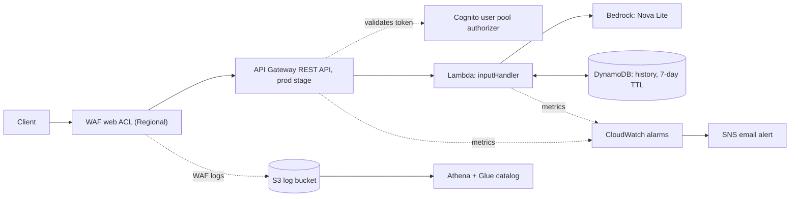

# Serverless AI Chatbot on AWS (REST API version)

> This is the REST API version. The earlier HTTP API + CloudFront version is in [`../http-api/`](../http-api/). The top-level [README](../README.md) compares the two.

## Summary
TODO: rewrite in your own words once WAF and logging are attached. Draft: A serverless architecture where a user signs in with Cognito, API Gateway's Cognito authorizer validates the token, Lambda sends the message to an AI model in Bedrock, and DynamoDB stores conversation history. A Regional WAF web ACL on the API stage handles rate limiting and known-bad traffic, and its logs go to S3 and are queried with Athena.

## Topics Learned
Draft bullets. Rewrite each in your own words and delete any you don't want to claim.
- REST APIs can front WAF without cloudfront, but instead you have to pay more per 1 million requests.
- A REST API stage is a named reference to a deployment, this allows you to work on a stage and only push it when ready. Similar to github version control.
- With the Cognito authorizer, leaving Authorization Scopes empty makes API Gateway treat the token as an ID token. Access tokens need scopes configured on the method (AWS docs).
- DynamoDB key names and types can't be changed on an existing table. A differently named partition key and a String sort key (instead of Number) each caused a `ValidationException`, and the table had to be recreated.
- A catch block that hides errors from clients also hides them from you unless it logs. Adding `logger.exception` is what exposed the Bedrock failure.
- IAM scoping was tested, not assumed: calling a different model (Nova Micro) returned `AccessDeniedException`, and switching back to Nova Lite worked.
- Reusing a `sessionId` carries old replies into the model's context, which skewed answers. A fresh session fixed it.
- Nova Lite sometimes refuses to repeat personal details (like a name) even when the user stated it earlier in the conversation.
- DynamoDB on-demand lets costs scale with use (lower use = lower costs).
- Athena bills by data scanned, so filtering by timestamp and keeping logs compressed keeps queries cheap. TODO: re-verify after the new log table.
- IAM users need least privileges to limit damage from compromised credentials. Root shouldn't be used for daily tasks.
- SQL `--` comments at the top of a CREATE EXTERNAL TABLE in Athena cause an EOF error (see `athena/README.md`).
- A fake Bedrock in unit tests allows testing without AWS calls. TODO: tests still target the earlier HTTP version (see Testing).
- Cost Explorer showed WAF as $0 while credits were applied. Excluding credits (Charge type: Usage) shows the real fixed monthly fees.
- TODO(after WAF): Authorization header redaction in WAF logs, rate-limit test result, and what a direct hit on the default execute-api URL shows.

## Architecture



TODO: this diagram assumes WAF is attached and logging. Adjust if you change the setup.

## Request flow

1. The client signs in with Cognito and receives an ID token.
2. The request goes to the API's `prod` stage (protected by a Regional WAF web ACL) with the ID token in the `Authorization` header.
3. API Gateway's Cognito authorizer validates the token. Missing or invalid token: 401.
4. Lambda validates the body and limits (2,000-character message, 128-character session ID), then reads the user ID (`sub`) from the verified claims (`requestContext.authorizer.claims.sub`), never from the request body. Missing or empty claim: 401.
5. Lambda loads up to the last 5 exchanges (capped at 6,000 characters) from DynamoDB, calls Bedrock's Converse API with a system prompt, saves the new exchange, and returns the reply.

## Services: what, why, cost, trade-off

| Service | Role here | Why this one | Cost model | Trade-off |
|---|---|---|---|---|
| API Gateway (REST API) (us-east-2) | Routes `POST /chat` on the `prod` stage, runs the Cognito authorizer, and is where WAF attaches | A REST API can have a WAF web ACL attached to a stage directly, so no CloudFront is needed in front. It also supports API keys, per-client throttling and request validation. | $3.50 per 1M requests for the first 333M per month (API Gateway pricing page; an HTTP API is $1.00 per 1M). | Costs more than an HTTP API. No native JWT authorizer, so it uses a Cognito user pool authorizer instead. Changes only go live after redeploying the stage. |
| AWS WAF (Regional, us-east-2) | Filters requests on the `prod` stage, writes logs | TODO(after attaching): rewrite in your words. It rate limits IP addresses to protect the Bedrock bill and covers known malicious IPs and exploits. | $5/month per web ACL plus $1/month per rule, plus $0.60 per 1M requests (AWS WAF pricing page). TODO: confirm against Cost Explorer once attached, with credits excluded. | TODO: fill in after testing (per-IP rate limit can be bypassed by changing IP; rules that don't apply to this project still cost $1/month each). |
| Cognito (us-east-2) | User sign-in, issues tokens | This uses AWS Services to handle token generation, account creation, and the storing of account information. | Free for the first 10,000 monthly users, $0.015 per monthly active user, Essentials tier, from the pricing page’s examples. | Validating and completing challenges (verification) to generate an auth token takes a bit of technical finesse and patience. Can sometimes run into issues with token generation, I noticed taking too long caused expired session strings, and users need to make a different password than the one the admin created. |
| Lambda (us-east-2) | Validation, history, Bedrock call | Lambda hosts serverless logic code that only runs when called. It was used to validate user input before sending to bedrock. Also handled sending user and assistant messages to DynamoDB for message history. | Free Tier: 1M requests and 400k GB-seconds, Then its $0.0000166667/GB-second for the next 6 billion GB-seconds, and $0.20 per 1M requests. | Code can only live for 15m, Can't rely on complex code that require persistent states between invocations, Cold-Starts (First starts) can have considerable delay. Must call boto3 clients in the module level and reused on warm invocations, this means its data can sometimes be transferred across requests and therefore per-user data must never be stored. |
| Bedrock (Nova Lite) (us-east-2)| Generates replies | Cost-effective for testing, cheap cost per token. | $0.06 per 1M input tokens and $0.24 per 1M output tokens (Nova Lite, Standard tier, US East (Ohio); AWS Bedrock pricing page, checked 2026-10-11). | Smaller model, so it may be less capable than frontier models on complex questions. |
| DynamoDB (us-east-2)| Conversation history (on-demand, Standard class, TTL) | On-Demand provides more/less read/write as traffic changes. Billed only for reads/writes used. A TTL helps keep storage from growing by expiring old history items. | (No on-demand request free tier listed) $0.625 per 1M writes (1KB), $0.125 per 1M reads (4KB), $0.25 per GB-month | Using On-Demand pays for requests which is disadvantageous for applications with steady traffic as it could cost more, Queries that require multiple keys require planning at creation of database and joins/ad-hoc queries are not supported by DynamoDB. |
| S3 + Athena + Glue catalog (us-east-1) | WAF log storage and SQL analysis | Longer term storage of logs, Stores compressed logs as durable storage and glue catalogs contain S3 table definition and allows Athena to query the table. |  S3 Standard: $0.023 per GB-month, $0.005 per 1000 PUT/COPY/POST/LIST request, and $0.0004 per GET/SELECT and other requests. Athena: $5 per TB of data scanned. Glue catalog: First 1M objects and 1M requests free, $1 per 100,000 objects or 1M requests per month. | WAF has a delay of about 5m before logs can be accessed. Requires filters otherwise Athena will scan everything (Costs increase by data scanned), so a partition projection "log_time" allows for Athena to only scan specific timeframes. Athena is for reading logs, so any attacks will not be alerted. |
| CloudWatch + SNS + Budgets (Cloudwatch/SNS: us-east-2; Budgets: Global)| Error alarms and cost alert by email | SNS email was used because of ease of creation. Cloudwatch is used to alert for Lambda or API Gateway 5xx errors. Budgets is used to check the current/expected costs of services and keep track and send an alert when costs grow unexpectedly or hit the configured threshold. | (Cloudwatch) Free: 5GB of data, 1,800 minutes of Live tail usage per month, 10 metrics, 1M api requests, 10 alarm metrics. With $0.10 per alarm metric. (SNS) Free: 1M Mobile notifications, 1000 emails, 100,000 HTTP/s. After it's: $0.50 per 1M mobile, $2 per 100,000 emails, $0.60 per 1M HTTP/s. (Budgets) Free: First two action-enabled budgets per month, after $0.10 per action-enabled budget per day. | Email can only be seen when user opens email. CloudWatch alarms only cover what's configured. Budgets don't set a hard cap, and are only for alerting and only update 3 times a day, so expect a delay before being notified. |
| IAM | Least-privilege role for Lambda, IAM user for daily work | To allow Lambda to only call one Bedrock model and read/write one DynamoDB table, a leaked daily credential won't compromise the whole AWS account, and a compromised Lambda does less damage. | IAM has no additional charge; you're charged only for the AWS services accessed with IAM users or roles (AWS IAM docs). | Requires technical knowledge to be precise with permissions (ARN formats are easy to get wrong). Admin account that is still with broad permissions has MFA. |

## Security notes

- **Authentication:** API Gateway's Cognito authorizer validates each ID token before Lambda runs. Missing or invalid token: 401.
- **Per-user isolation:** the history key is `<Cognito sub>#<sessionId>`. The `sub` comes from the verified token, never from the request body. TODO: record the two-user isolation test result.
- **Input limits:** Lambda rejects bad input (400) before calling Bedrock: 2,000-character message, 128-character session ID.
- **Least-privilege Lambda role:** `bedrock:InvokeModel` on the Nova Lite foundation-model ARN only (tested: another model returns `AccessDeniedException`), and `Query` and `PutItem` on one DynamoDB table. It cannot delete items, scan, or touch other tables. (`PutItem` can replace an item that has the same key.)
- **Generic client errors:** Bedrock failures return a generic 502 instead of the real error. The real error is logged server-side.
- **WAF:** TODO(after attaching): rate-based rule, managed rule groups, and the tested result.
- **Log hygiene:** TODO(after WAF logging): `Authorization` header redaction.
- **Account hygiene:** daily work uses an IAM user, not root. MFA is enabled on both. No root access keys exist.

## Testing

TODO: decide before pushing. The 33 unit tests in `test_inputHandler.py` were written for the HTTP version. They build fake events with `authorizer.jwt.claims` and assert the old `converse` arguments (no `system`). Either update the fake events and that test, or say here that they cover the earlier version only.

Checked by hand against the deployed REST API:
- No token: 401. ID token: 200 and an AI reply.
- History saved to and read back from DynamoDB (a fresh `sessionId` remembered a stated colour).
- Lambda console tests with `claims` null, empty and empty-`sub` returned 401.
- Calling a different Bedrock model returned `AccessDeniedException` (IAM scoping).
- TODO: second user cannot read the first user's history. TODO: rate limit returns 403. TODO: direct-URL test.

## Log analysis

TODO(after WAF logging): update `athena/01_create_table.sql` for the Regional ACL (the log path has the Region and web ACL name instead of `cloudfront`), and check whether the log bucket must share the ACL's Region.

## Known limitations

- **Rate limit is per IP.** Changing IP can bypass it.
- **History failures are silent.** If loading or saving history fails, the chat continues without it, and nothing alerts me.
- **Model behavior.** Nova Lite can refuse to repeat personal details such as a name, and may claim it can't remember a conversation it was given. A system prompt reduces this but doesn't guarantee it.
- **TTL deletion not yet observed.** TTL is enabled (7 days), but I haven't seen an item expire.
- **Console-built.** Resources were created by hand in the console, so they aren't reproducible yet.
- **REST API costs more per request** than an HTTP API ($3.50 vs $1.00 per 1M).
- **Daily IAM user is an administrator,** protected by MFA.
- **Alerts:** email alarms cover Lambda errors and API 5xx only. Budgets alert on cost but don't cap spending.
- TODO: WAF fixed monthly cost line, and the direct execute-api URL result.

## Repository layout

```
inputHandler.py          Lambda handler (REST event shape)
test_inputHandler.py     unit tests (TODO: update)
athena/                  table definition, saved queries, notes
README.md
```

## Sources

- [Create a REST API with a Lambda proxy integration](https://docs.aws.amazon.com/apigateway/latest/developerguide/api-gateway-create-api-as-simple-proxy-for-lambda.html), [Integrate a REST API with a Cognito user pool](https://docs.aws.amazon.com/apigateway/latest/developerguide/apigateway-enable-cognito-user-pool.html), [Set up a stage for a REST API](https://docs.aws.amazon.com/apigateway/latest/developerguide/set-up-stages.html), [API Gateway pricing](https://aws.amazon.com/api-gateway/pricing/)
- [Converse API reference](https://docs.aws.amazon.com/bedrock/latest/APIReference/API_runtime_Converse.html), [Bedrock pricing](https://aws.amazon.com/bedrock/pricing/), [Nova Lite model card](https://docs.aws.amazon.com/bedrock/latest/userguide/model-card-amazon-nova-lite.html)
- [Cognito pricing](https://aws.amazon.com/cognito/pricing/), [InitiateAuth (CLI)](https://docs.aws.amazon.com/cli/latest/reference/cognito-idp/initiate-auth.html), [RespondToAuthChallenge (CLI)](https://docs.aws.amazon.com/cli/latest/reference/cognito-idp/respond-to-auth-challenge.html)
- [Lambda pricing](https://aws.amazon.com/lambda/pricing/), [quotas](https://docs.aws.amazon.com/lambda/latest/dg/gettingstarted-limits.html), [execution environment](https://docs.aws.amazon.com/lambda/latest/dg/lambda-runtime-environment.html), [best practices](https://docs.aws.amazon.com/lambda/latest/dg/best-practices.html)
- [DynamoDB on-demand pricing](https://aws.amazon.com/dynamodb/pricing/on-demand/), [capacity modes](https://docs.aws.amazon.com/amazondynamodb/latest/developerguide/capacity-mode.html)
- [AWS WAF pricing](https://aws.amazon.com/waf/pricing/), [WAF logging to S3](https://docs.aws.amazon.com/waf/latest/developerguide/logging-s3.html)
- [S3 pricing](https://aws.amazon.com/s3/pricing/), [Athena pricing](https://aws.amazon.com/athena/pricing/), [Glue pricing](https://aws.amazon.com/glue/pricing/)
- [CloudWatch pricing](https://aws.amazon.com/cloudwatch/pricing/), [SNS pricing](https://aws.amazon.com/sns/pricing/), [Budgets pricing](https://aws.amazon.com/aws-cost-management/aws-budgets/pricing/), [Budgets docs](https://docs.aws.amazon.com/cost-management/latest/userguide/budgets-managing-costs.html)
- [IAM introduction](https://docs.aws.amazon.com/IAM/latest/UserGuide/introduction.html)
- [AWS global services and control planes](https://docs.aws.amazon.com/whitepapers/latest/aws-fault-isolation-boundaries/global-services.html)
